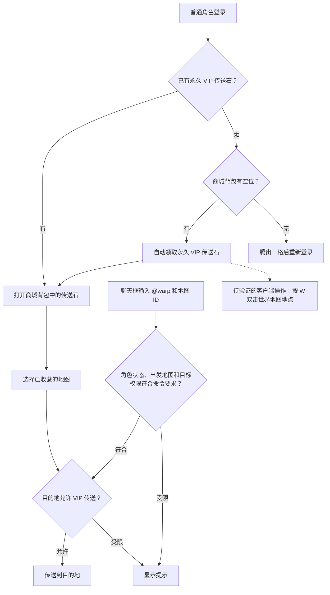

# v83 玩家传送

目标是让普通玩家直接前往常规地图，沿用 VIP 传送石的禁传规则，并尽量省去查询地图 ID 的步骤。截至 2026-11-20，永久 VIP 传送石和 `@warp` 已部署到 `my4g`，世界地图双击仍待客户端实测。

## 玩家用法

- **永久 VIP 传送石（`5041000`）**。登录时按角色发放，已有永久石时跳过。道具不扣数量，允许跨大陆，原版界面最多收藏 10 张地图。
- **聊天命令**。例如 `@warp 100000000` 前往射手村。普通玩家受死亡、副本内和禁传出发地图等限制，目的地另行限制 GM 地图和监狱。
- **禁传规则**。服务端共用 VIP 传送石的目的地判定，检查地图的禁用传送石标志和强制返回设置，保留彩虹岛原有例外。

## 世界地图双击

较新的官方版本支持通过超级传送石在世界地图上选点传送。这套 v83 的地图点已有 `mapNo`，但持有 VIP 传送石时是否有原生双击入口，仍需实测。此前双击无反应时，打开的是连 `my4g` 的客户端，当时永久石仅部署在本地测试服。 [Nexon 传送石说明](https://support-maplestory.nexon.com/hc/en-us/articles/204744475-How-do-the-different-types-of-Teleport-Rocks-work) · [MapleStorySEA 更新公告](https://www.maplesea.com/updates/view/v242_Patch_Notes_2/)

用原来的 CrossOver 脚本连接 `my4g`，以普通角色确认已领取永久石，然后按 `W` 双击射手村。若仍无反应，用背包里的传送石测试已收藏地图和使用次数。若需补做双击入口，可以让客户端读出地图点的 `mapNo`，再由服务端按现有规则判定。

## 部署与验证

- 本地测试服通过 `cosmic-dev/启动冒险岛-测试服.command` 进入。日常 CrossOver 脚本 `启动冒险岛-CrossOver.command` 连接 `my4g`。
- `my4g` 的部署目录是 `/opt/maple-poc`。Maven 构建及测试通过，游戏容器已重启，新 JAR 的 SHA-256 校验一致，登录和频道端口已就绪。
- 部署前的 JAR 和本次修改涉及的源码备份在 `/opt/maple-poc/vip-rock-backup.ABFSPF`。游戏内领取、连续使用和世界地图双击仍待普通角色实测。
